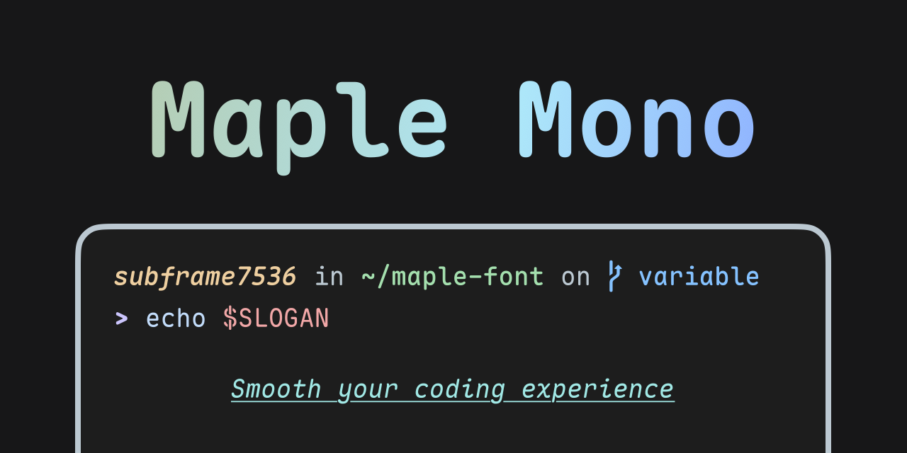
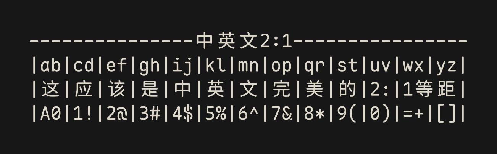

<p align="center">
  <a href="https://trendshift.io/repositories/13165" target="_blank"></a>
  <a href="https://hellogithub.com/repository/0601f355bd824d88b58f1af3066c486a" target="_blank"></a>
</p>
<p align="center">
  
  
  
</p>
<p align="center">
  
  
  
  
</p>

<p align="center">
  <a href="#安装">下载</a> |
  <a href="https://font.subf.dev">网站</a> |
  <a href="https://font.subf.dev/zh-cn/playground">在线体验</a> |
  <a href="#文档">文档</a> |
  <a href="./README.md">English</a> |
  中文 |
  <a href="./README_TC.md">繁中</a> |
  <a href="./README_JP.md">日本語</a> |
  <a href="./README_KR.md">한국어</a>
</p>

> [!WARNING]
> 当前分支为 V8 版本，仍在开发中，尚未正式发布。如果你需要使用稳定版本，请前往 [`v7` 分支](https://github.com/subframe7536/maple-font/tree/v7)。

# Maple Mono

Maple Mono 是一款开源等宽字体，致力于让编码体验更加舒适、高效。我制作它是为了提升自己的工作效率，也希望它能帮助更多人更愉快地编写代码。

## 亮点

- ✨ **可变字重** - 支持连续调节字重，并针对斜体字形进行细致优化，让排版控制更加灵活。
- ☁️ **圆角字形** - 全面采用圆角设计，重绘 `@ $ % & Q ->` 等关键符号，优化斜体连笔（`f i j k l x y`）。
- 🪄 **智能连字** - 支持大量智能连字，提供丰富的字符变体和 OpenType 样式集，内置标签连字，帮助代码更易读，也更有表现力。
- 🔣 **Unicode 扩展覆盖** - 覆盖制表符、盲文、数学运算符（U+2200–U+22FF）、国际象棋与扑克牌符号、终端状态与进度符号，以及 Claude Code 状态加载符号等。
- 🎨 **Nerd Font 图标** - 原生集成 [Nerd Fonts](https://github.com/ryanoasis/nerd-fonts)，兼容各类开发工具和终端环境，让界面信息更清晰易读。
- 🀄 **CJK 2:1 对齐** - 简体中文、繁体中文、日文和韩文字形宽度恰好为拉丁字符的两倍，多语言文本和 Markdown 表格保持整齐。
- 📏 **三种字宽** - 提供 default、narrow、slim 三种字符宽度。
- 🔨 **高度可定制** - 支持配置 OpenType 特性、标签连字、行高、字符宽度和字重映射，也可以从源码生成专属字体。

## CJK

CJK 字符与英文字符按 2:1 的宽度对齐，让多语言文本和 Markdown 表格保持整齐；相应地，默认 CJK 字符的间距会比其他常见中文字体更宽（[原因](https://github.com/subframe7536/maple-font/issues/211)）。与 V7 相比，V8 大幅扩充并优化了 CJK 字符集。

| 地区 | 覆盖范围                           | CJK 字库来源                                                                             |
| ---- | ---------------------------------- | ---------------------------------------------------------------------------------------- |
| CN   | 简体中文，并覆盖常用繁体与日文字符 | [WenYuan Rounded SC](https://github.com/takushun-wu/WenYuanFonts)                        |
| TC   | 繁体中文                           | [Chiron Go Round TC](https://github.com/chiron-fonts/chiron-go-round-tc)                 |
| JP   | 日文                               | [Resource Han Rounded JP](https://github.com/CyanoHao/Resource-Han-Rounded)              |
| KR   | 韩文                               | [Chiron Go Round TC](https://github.com/chiron-fonts/chiron-go-round-tc)，按韩文区域筛选 |



详情见 [CJK 构建](./documentation/cjk.md)。

## 我个人在用的其他中文字体资源

参见 [cn-resource](https://github.com/subframe7536/maple-font/tree/other-resources/cn-resource) 和 [cn-base](https://github.com/subframe7536/maple-font/releases/tag/cn-base)。

## 预览


生成工具：[CodeImg](https://github.com/subframe7536/vscode-codeimg)，主题：[Maple](https://github.com/subframe7536/vscode-theme-maple)，字号 16px，行高 1.8，默认字母间距。

## 连字与变体

Maple Mono 提供智能连字（通过 `calt` 启用）、字符变体（`cvXX`）和样式集（`ssXX`），绝大多数现代操作系统、浏览器、终端和编辑器都支持。完整列表见 [OpenType 特性](./documentation/opentype-features.md)，也可以在[在线体验](https://font.subf.dev/zh-cn/playground)中实时预览。

## 样式一览

- **Normal 预设** - 风格更中性，字形类似 `JetBrains Mono`，`0` 中间为斜线。
- **无限箭头连字** - 受 Fira Code 和 Cascadia Code 启发，箭头连字可以无限延长。
- **三种字宽** - 拉丁字符宽度可选 default（600）、narrow（550）、slim（500）。
- **Nerd Font 图标** - 图标间距可选默认、固定宽度（`NFMono`）或可变宽度（`NFPropo`）。

| Normal 预设                                          | 无限箭头连字                                                          |
| ---------------------------------------------------- | --------------------------------------------------------------------- |
|     |  |
| **字宽**                                             | **Nerd Font 图标**                                                    |
|  |        |

各样式的构建方法见[构建选项](./documentation/build-options.md)。

## 安装

你可以从 [Releases](https://github.com/subframe7536/maple-font/releases/latest) 下载字体压缩包，或通过包管理器安装最常用的 Maple Mono NF CN：

```sh
# Scoop (Windows)
scoop bucket add nerd-fonts
scoop install Maple-Mono-NF-CN
# Homebrew (macOS, Linux)
brew install --cask font-maple-mono-nf-cn
# Arch Linux (archlinuxcn)
paru -S ttf-maplemono-nf-cn-unhinted
# Nixpkgs：将 `maple-mono.NF-CN-unhinted` 添加到 `fonts.packages`
```

包管理器目前提供的是 v7.9 版本。CDN：[fontsource](https://fontsource.org/fonts/maple-mono)、[ZeoSeven Fonts](https://fonts.zeoseven.com/items/443/)；Maple Mono CN：[中文网字计划](https://chinese-font.netlify.app/zh-cn/fonts/maple-mono-cn/MapleMono-CN-Regular)、[ZeoSeven Fonts](https://fonts.zeoseven.com/items/442/)。全部软件包见[安装指南](./documentation/install.md)。

## 我该选择哪个文件？

| 使用场景          | 推荐选择                              |
| ----------------- | ------------------------------------- |
| 日常编码          | `TTF` 或 `OTF`                        |
| 终端图标          | `NF`、`NFMono` 或 `NFPropo`           |
| 图标与 CJK        | `NF-CN`、`NF-TC`、`NF-JP` 或 `NF-KR`  |
| 网页              | `WOFF2`                               |

所有软件包及 hinted / unhinted 的区别见[字体选择](./documentation/choose.md)。

## 使用

VS Code、JetBrains IDE、Zed、Windows Terminal、Kitty 和 Ghostty 的配置方法见[使用指南](./documentation/usage.md)。

## 自行构建

上面的所有亮点都可以在构建时通过 [`config.json`](./config.json) 或 `build.py` 参数调整。你可以在[在线体验](https://font.subf.dev/zh-cn/playground)中直接构建，也可以使用 [GitHub Actions](https://github.com/subframe7536/maple-font/actions/workflows/custom.yml) 云端构建，或通过 Docker / Python 本地构建，详情见[自定义构建](./documentation/build.md)。

## 文档

文档目前仅提供英文版本。

- **入门**：[安装](./documentation/install.md) · [命名与字体选择](./documentation/choose.md) · [使用](./documentation/usage.md) · [OpenType 特性](./documentation/opentype-features.md)
- **构建**：[自定义构建](./documentation/build.md) · [构建选项](./documentation/build-options.md) · [CJK 构建](./documentation/cjk.md) · [`build.py` 命令行参考](#buildpy-cli)
- **参与开发**：[开发](./documentation/development.md) · [Google Fonts 构建与 QA](./documentation/google-fonts.md)

<a id="buildpy-cli"></a>

## `build.py` 命令行选项

```text
用法：build.py [-h] [-v] [-d] [--debug] [-n] [--standard-zero]
               [--legacy-thin-weight-class] [--feat FEAT] [--apply-fea-file]
               [--hinted | --no-hinted] [--liga | --no-liga]
               [--infinite-arrow | --no-infinite-arrow] [--remove-tag-liga]
               [--line-height LINE_HEIGHT] [--width {default,narrow,slim}]
               [--format FORMATS] [--least-styles] [--cache] [--archive]
               [--nf | --no-nf] [--nf-mono] [--nf-propo] [--nf-variable]
               [--font-patcher] [--cjk CJK] [--cjk-variable] [--cjk-narrow]
               [--cjk-scale-factor CJK_SCALE_FACTOR] [--cjk-both]
               [--cjk-hinted | --no-cjk-hinted] [--cn | --no-cn]
               [--cn-narrow] [--cn-scale-factor CN_SCALE_FACTOR] [--cn-both]

Maple Mono 构建与优化工具

选项：
  -h, --help            显示帮助信息并退出
  -v, --version         显示程序版本并退出
  -d, --dry             输出配置并退出
  --debug               使用快速调试构建：添加 `Debug`、启用调试日志、
                        仅构建 Regular/Italic，并跳过 OTF/WOFF2/Nerd Font 输出

特性选项：
  -n, --normal          使用 Normal 预设，生成类似 `JetBrains Mono` 的字形，
                        其中 0 使用斜线样式
  --standard-zero       使用标准 zero 语义：默认显示圆点，启用 `zero` 后显示斜线
  --legacy-thin-weight-class
                        使用旧版 weight class 值（250/275 而非 100/200）
                        用于 Thin 和 ExtraLight 静态字体，以解决 Windows 上
                        JetBrains IDE 中的 GDI 伪粗体问题
  --feat FEAT           启用并冻结指定特性，以逗号分隔
                        （例如 `--feat zero,cv01,ss07,ss08`）；上下文规则通过
                        `calt` 启用
  --apply-fea-file      将匹配的
                        `sources/features/{regular,italic}{_cn,}.fea` 应用到静态和可变字体
  --hinted              在 NF/CJK/NF-CJK 中使用 Hinted 字体作为基础字体（默认）
  --no-hinted           在 NF/CJK/NF-CJK 中使用未加提示的字体作为基础字体
  --liga                保留所有连字（默认）
  --no-liga             移除所有连字
  --infinite-arrow      添加无限箭头连字支持（默认）
  --no-infinite-arrow   不添加无限箭头连字支持
  --remove-tag-liga     移除类似 `[TODO]` 的纯文本标签连字
  --line-height LINE_HEIGHT
                        行高缩放因子（例如 1.1）
  --width {default,narrow,slim}
                        设置字形宽度：default（600）、narrow（550）、slim（500）

构建选项：
  --format FORMATS      以逗号分隔的列表选择所需基础输出格式：ttf、otf、woff2；
                        可变字体基础版本始终会构建
  --least-styles        仅构建 Regular/Bold/Italic/BoldItalic 样式
  --cache               复用 `fonts/` 下有效的缓存流水线阶段，并保留其他已有输出
  --archive             使用配置和许可证，将每个已有的非 JSON 输出目录归档

Nerd Font 选项：
  --nf, --nerd-font     构建 Nerd Font 版本（默认）
  --no-nf, --no-nerd-font
                        不构建 Nerd Font 版本
  --nf-mono             固定 Nerd Font 图标的宽度
  --nf-propo            使 Nerd Font 图标宽度可变，覆盖 `--nf-mono`
  --nf-variable         构建 Nerd Font 可变字体
  --font-patcher        强制使用 Nerd Font Patcher 构建 NF 格式

CJK 选项：
  --cjk CJK             构建 Maple Mono + CJK 扩展字体，区域为 cn、jp、tc、kr。
                        可重复指定或使用逗号分隔的值。
  --cjk-variable        将 CJK 扩展输出保留为合并的可变字体
  --cjk-narrow          对选定区域应用窄 CJK 间距
  --cjk-scale-factor CJK_SCALE_FACTOR
                        设置选定 CJK 区域的缩放因子。格式为：
                        <factor> 或 <width_factor>,<height_factor>
  --cjk-both            启用 Nerd Font 时，同时构建 NF CJK 和非 NF CJK 输出
  --cjk-hinted          自动为最终静态 CJK 字体添加提示
  --no-cjk-hinted       不为最终静态 CJK 字体添加提示（默认）

已弃用的 CN 选项：
  --cn                  已弃用的 `--cjk cn` 别名
  --no-cn               已弃用的从所选 CJK 区域中移除 `cn` 的别名
  --cn-narrow           已弃用的针对 `cn` 使用 `--cjk-narrow` 的别名
  --cn-scale-factor CN_SCALE_FACTOR
                        已弃用的针对 `cn` 使用 `--cjk-scale-factor` 的别名
  --cn-both             已弃用的 `--cjk-both` 别名
```

## 鸣谢

- [JetBrains Mono](https://github.com/JetBrains/JetBrainsMono)
- [Fira Code](https://github.com/tonsky/FiraCode)
- [Cascadia Code](https://github.com/microsoft/cascadia-code)
- [Roboto Mono](https://github.com/googlefonts/RobotoMono)
- [Victor Mono](https://github.com/rubjo/victor-mono)
- [Commit Mono](https://github.com/eigilnikolajsen/commit-mono)
- [Code Sample](https://github.com/TheRenegadeCoder/sample-programs-website)
- [Nerd Font](https://github.com/ryanoasis/nerd-fonts)
- [Font Freeze](https://github.com/MuTsunTsai/fontfreeze/)
- [Font Viewer](https://tophix.com/font-tools/font-viewer)
- [Monolisa](https://www.monolisa.dev/)
- [Recursive](https://www.recursive.design/)

## 赞助

如果这个字体对你有所帮助，欢迎通过[爱发电](https://afdian.com/a/subframe7536)赞助我。

## 点星

<a href="https://star-history.dera.page/#subframe7536/maple-font&type=date&legend=top-left">
 <picture>
   <source media="(prefers-color-scheme: dark)" srcset="https://star-history.dera.page/svg?repos=subframe7536/maple-font&type=date&theme=dark&legend=top-left" />
   <source media="(prefers-color-scheme: light)" srcset="https://star-history.dera.page/svg?repos=subframe7536/maple-font&type=date&legend=top-left" />
   
 </picture>
</a>

## 许可

SIL Open Font License 1.1
